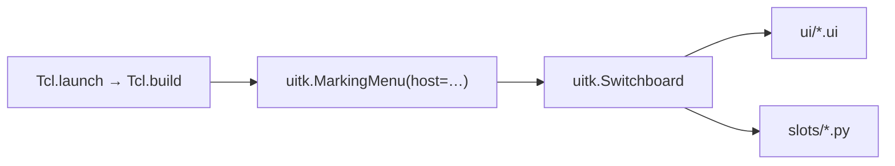

[](../test/)
[](https://www.gnu.org/licenses/gpl-3.0.en.html)
[](https://pypi.org/project/tentacletk/)


# Tentacle

A Qt marking-menu launcher for DCC apps.

Built on [`uitk.MarkingMenu`](https://github.com/m3trik/uitk/blob/main/uitk/widgets/marking_menu/_marking_menu.py), it ships 60+ tool panels spanning the full pipeline (modeling, UV, materials, rigging, animation, rendering, …), each one panel for both Maya and Blender — a starting set you can build on, or replace wholesale with your own — and opens extapps' [standalone apps](#standalone-apps) by name.


## Install

Download [`tentacle_installer.py`](https://github.com/m3trik/tentacle/releases/latest/download/tentacle_installer.py) — one file for every DCC, no administrator rights, nothing to type:

| DCC | Do this |
| --- | --- |
| Maya 2025+ | Drag the file into the viewport. |
| Blender 4.1+ | *Edit ▸ Preferences ▸ Add-ons ▸ Install from Disk…* (under the ⌄ menu; *Install…* on 4.1), pick the file, and tick **Tentacle Marking Menu** if it is not already on. |

The first start fetches `tentacletk` and the engine for your host (`mayatk` / `blendertk`; Blender also gets PySide6) from PyPI — about a minute, with progress in the host — and the menu is live: hover the viewport and hold **Z**. Everything lands in a per-user folder the host already imports from (`<Maya prefs>/<version>/tentacle/`, Blender's `scripts/addons/modules/`); the DCC's own install is never touched. The DCC's Python needs to reach PyPI (proxy / firewall).

**Update or uninstall:** drop the file in again (Maya) or open the add-on's preferences (Blender). Either applies at the next start if the menu is already running. In Blender use the add-on's own **Uninstall**: Blender's *Remove* button deletes only the add-on file and leaves the packages in `scripts/addons/modules/`. Settings brought over from an older Blender with *Load Previous Settings* can carry packages built for that version's Python. The first start on the new version reinstalls them, and so does **Update**.

**Scripted, no UI:** `"<mayapy>" tentacle_installer.py install|update|uninstall` · `blender --background --python tentacle_installer.py -- install|update|uninstall` (exit code 1 when the verb failed, an install that did not take included). **Developers:** `pip install "tentacletk[maya]"` / `"tentacletk[blender]"` into the DCC's own Python, or `pip install -e ./tentacle` from a checkout (see [Development](#development)); the extra in brackets is the engine — plain `tentacletk` has none and the menu will not start.

## Activation key

`Z` by default. Change it any time from the in-app **Preferences** panel.

Starting Tentacle from your own startup script is two lines — `Tcl.launch` detects the host and defers startup however that host needs — and `key_show` names the default it starts with:

```python
from tentacle import Tcl
Tcl.launch(key_show="Z")   # bare ("Z", "Space") or Qt-named ("Key_F11")
```

Maya: `userSetup.py` (in `~/Documents/maya/<version>/scripts/`); Blender: `startup.py` in `%APPDATA%\Blender Foundation\Blender\<version>\scripts\startup\`. See [Platform support](#platform-support).

## Bindings

Holding the activation key opens a menu; adding mouse buttons picks which one. Shown with the default `Z`:

| Chord                                | Opens                 |
| ------------------------------------ | --------------------- |
| `Z`                                | `hud#startmenu`       |
| `Z + LMB`                          | `cameras#startmenu`   |
| `Z + MMB`                          | `editors#startmenu`   |
| `Z + RMB`                          | `main#startmenu`      |
| `Z + LMB + RMB`                    | `maya#startmenu`      |

(In Blender the both-button chord opens `blender#startmenu` — the native menu sets.)

To change the activation key later, use the in-app **Preferences** panel or the shortcut editor's *Show Marking Menu* row — or, in Blender, *Preferences ▸ Keymap* ▸ `3D View` ▸ *Tentacle Marking Menu*. Either way the whole chord table moves with it and the choice is remembered, outranking the `key_show` default your launch script names.

The table is built in [`tcl.py`](../tentacle/tcl.py); chord syntax, gesture mechanics, and the full customization surface are covered in [`uitk/docs/MARKING_MENU.md`](https://github.com/m3trik/uitk/blob/main/docs/MARKING_MENU.md).

## How it works



`Tcl.launch` resolves the host's adapter from its toolkit (`Tcl.ADAPTERS`: `mtk.MayaMarkingMenuHost` / `btk.BlenderMarkingMenuHost`, each a `uitk.MarkingMenuHost` to the menu and a `uitk.MarkingMenuLaunchHost` to the launcher), defers through it, and `Tcl.build` makes the one `uitk.MarkingMenu(host=…)`: the host's main window, activation-key half, mouse and window stacking are the adapter's; the native-menu pages (`ui/<host>_menus`), the both-button chord's `<host>#startmenu` and the `{host}` context tag come from the host name.

`uitk.Switchboard` pairs each `.ui` file with a slot module **of the same basename**, then connects each widget's `objectName` to a method of the same name on the slot class:

```
ui/materials.ui          ──pairs with──►   slots/materials.py
  └─ widget objectName "b005"  ──calls──►    def b005(self): ...
  └─ widget objectName "b005"  ──setup──►    def b005_init(self, widget): ...  (optional)
```

That's the whole convention. Widget object names are arbitrary; whatever name a widget has, a method of that name on the slot class will fire when it's interacted with.

Submenu routing: a widget's `accessibleName` (e.g. `"cameras#lower"`) names the submenu UI to open when the gesture lands on it.

## Customization

`Tcl.launch` forwards anything extra to `Tcl.build` and the `uitk.MarkingMenu` it makes (a relative `slot_source` is relative to the `tentacle` package):

```python
Tcl.launch(
    key_show="F11",
    slot_source="my_studio/slots",   # use your own slot library
    log_level="DEBUG",
    bindings={                        # replace defaults entirely
        "Key_F11":               "main#startmenu",
        "Key_F11|RightButton":   "cameras#startmenu",
    },
)
```

User preferences (theme, repeat-last shortcut, etc.) live in the in-app **Preferences** panel.

## Standalone apps

The content-pipeline tools that need no DCC -- the Map Compositor, Map Converter,
Map Packer and Mesh Converter, the Metashape / RealityCapture / Brush Splat
photogrammetry workflows, the Substance, Marmoset and Unity workflows, the WebXR
Preview and Look Match -- are [extapps](https://github.com/m3trik/extapps)', a
separate product: each app's engine, panel and Slots class live there. In Maya or
Blender the menus open nine of them by name through uitk's external-app handler,
which finds them wherever extapps is installed: the Map Packer, Converter and
Compositor and the three photogrammetry workflows (Materials), the Mesh Converter
and the Unity Workflow (Scene) and the WebXR Preview (Rendering); the UI Browser
lists them all. The Unity Workflow and the WebXR Preview get the host's engine
(`mtk` / `btk` `UnityBridge`, `WebXrPreview`), so they send the scene as well as a
file: the host exports, the app delivers. Outside
a DCC, `extapps` (or `python -m extapps [app]`) opens them. tentacle does not
depend on extapps.

## Project layout

```
tentacle/
├── tcl.py                 Tcl.launch / Tcl.build — the one launcher: host detection, ONE
│                          uitk.MarkingMenu(host=…) per host, the activation-key/chord contract
├── tcl_blender.py         Blender add-on stub — bl_info, register/unregister, launch/reload/diagnose
├── slots/
│   ├── _slots.py          Slots base — repeat-last-command shortcut
│   ├── <category>.py      one Slots class per marking-menu category, both hosts
│   └── tools/             one Slots class per tool panel (Qt helpers in _<tool>/)
└── ui/                    .ui definitions; tools/ the tool panels; maya_menus/ + blender_menus/ the
                           chord menus' pages onto each host's own menus (navigation, no Slots class)
```

## Platform support

| DCC         | Status                                                 |
| ----------- | ------------------------------------------------------ |
| Maya 2025+  | Full — entry point, slot library, all menus wired.     |
| Blender     | Full — the same launcher, slot library and tool panels as Maya (a Maya-only tool is hidden); blendertk hosts Qt and bridges the activation key from the 3D View keymap ([`tcl_blender.py`](../tentacle/tcl_blender.py) is the add-on stub). |

## Development

```bash
git clone https://github.com/m3trik/tentacle
pip install -e ./tentacle
cd tentacle && python -m pytest test/
```

CI runs `test_package.py`, `test_slot_integrity.py`, `test_ui_integrity.py`, and module-specific suites — see [`.github/workflows/tests.yml`](../.github/workflows/tests.yml).

## More

- [`API_REGISTRY.md`](../API_REGISTRY.md) — every public class/method, with file:line links.
- [`CHANGELOG.md`](../CHANGELOG.md) — notable changes.
- [`CLAUDE.md`](../CLAUDE.md) — contributor conventions.
- [`uitk/docs/MARKING_MENU.md`](https://github.com/m3trik/uitk/blob/main/docs/MARKING_MENU.md) — chord syntax, gesture mechanics.

## License

GPL-3.0-or-later — see [COPYING](https://github.com/m3trik/tentacle/blob/main/COPYING), plus an additional permission to combine it with mayatk and Autodesk Maya ([COPYING.EXCEPTION](https://github.com/m3trik/tentacle/blob/main/COPYING.EXCEPTION)). Copyright (C) 2021-2026 m3trik@live.com.
